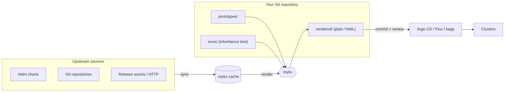

# Myks

**Render the Kubernetes manifests for every cluster you run from one Git
repository, and review the exact YAML each change produces before it ships.**

Myks (**M**anage (**my**) **y**aml for **K**ubernetes **s**imply) takes upstream
Helm charts, Git repositories and plain YAML, applies your per-cluster
configuration, and writes plain Kubernetes manifests to a `rendered/` directory.
You commit that output. Argo CD, Flux, kapp or `kubectl` deploy static YAML, and
every pull request shows reviewers what changes in which cluster.

[Getting started](https://mykso.github.io/myks/getting-started/) ·
[Documentation](https://mykso.github.io/myks/) ·
[Why myks](https://mykso.github.io/myks/concepts/why-myks/) ·
[Examples](examples/README.md) ·
[Slack](https://kubernetes.slack.com/archives/C06BVDBHZC2)

## The problem

You run several clusters. Each needs mostly the same applications, with small
differences: a chart version held back in production, more replicas in one
region, a label every cluster adds, a fix to an upstream chart that the
maintainers have not merged yet. The usual answers are a values file per cluster
per chart, a fork of the chart, or a templating layer in front of Argo CD. They
share a flaw: nobody sees the manifests that will reach the cluster until they
are applied.

## What myks does

Change a value, run `myks render`, and look at the diff:

```console
$ mkdir -p envs/prod/_apps/httpbingo/helm
$ echo 'replicaCount: 3' > envs/prod/_apps/httpbingo/helm/httpbingo.yaml
$ myks render
$ git diff --stat
 rendered/envs/prod/httpbingo/deployment-httpbingo.yaml | 2 +-
$ git diff rendered/
-  replicas: 1
+  replicas: 3
```

Only the production cluster changes, and only the one field. Myks found the
affected application from the files you touched, so it rendered nothing else.



## Features

- **Every change is reviewable.** Output is sorted, deterministic and split into
  one file per resource (`deployment-httpbingo.yaml`), so a pull request diff is
  the change the cluster will receive.
- **Define once, override where needed.** Environments form a directory tree
  (root → group → cluster). Each level inherits from its parents, and
  applications are instances of reusable prototypes.
- **Any upstream source.** [vendir] fetches Helm charts from HTTP and OCI
  repositories, Git repositories, GitHub releases and plain URLs. A shared cache
  downloads each source once, even when many applications use it.
- **Patch upstream charts without forking them.** [ytt] overlays modify the
  rendered output of a chart for one application, for one prototype, or for
  every application of an environment.
- **Fast on large fleets.**
  [Smart Mode](https://mykso.github.io/myks/concepts/smart-mode/) renders only
  the applications affected by your changes, and applications render in
  parallel.
- **Argo CD built in.** Myks generates an `Application` per application, plus an
  `AppProject` and a cluster `Secret` per environment
  ([details](https://mykso.github.io/myks/guides/argocd/)).
- **Pinned images.** Optional [kbld] integration resolves image tags to digests
  and rewrites registries, for mirrors and air-gapped clusters
  ([details](https://mykso.github.io/myks/guides/kbld/)).
- **Know where each value comes from.** `myks inspect apps --provenance` names
  the file that sets every final value, and `--redundant` reports overrides that
  change nothing ([details](https://mykso.github.io/myks/guides/inspect/)).
- **Extensible.** Any executable named `myks-*` becomes a subcommand that runs
  per application, for deploying with kapp or validating with kubeconform
  ([details](https://mykso.github.io/myks/guides/plugins/)).
- **One binary.** ytt, vendir and kbld are built in. Only `helm` is an external
  dependency, and only for Helm charts.

Myks runs in production at scale: one installation renders about 680 Argo CD
Applications for 25 clusters from 61 prototypes.

## Is myks for you?

Myks fits when you manage several clusters (or several environments of one) from
Git, consume third-party Helm charts or manifests, and want to review rendered
output before deploying it.

Myks does not talk to clusters, does not build images, and does not deploy
anything by itself. It produces YAML; your GitOps controller or a plugin applies
it. See [Why myks](https://mykso.github.io/myks/concepts/why-myks/) for a
comparison with Helm, Kustomize, Helmfile and Argo CD's own templating.

## Quick start

Install myks and Helm (see
[Installation](https://mykso.github.io/myks/guides/installation/) for all
options):

```shell
brew install --cask mykso/tap/myks
brew install helm
```

Create a project and render it:

```shell
mkdir my-gitops && cd my-gitops
git init && git commit --allow-empty -m 'Initial commit'
myks init     # scaffolds two environments, dev and prod, with a demo app
myks render   # downloads the charts and renders every manifest
find rendered -type f
```

Continue with the
[Getting started](https://mykso.github.io/myks/getting-started/) tutorial: it
adds a second cluster, overrides a value for it, and patches a chart.

## Documentation

| If you want to                       | Read                                                                                                                                                                 |
| ------------------------------------ | -------------------------------------------------------------------------------------------------------------------------------------------------------------------- |
| Try myks in 10 minutes               | [Getting started](https://mykso.github.io/myks/getting-started/)                                                                                                     |
| Understand the model                 | [Concepts](https://mykso.github.io/myks/concepts/core/)                                                                                                              |
| Do a specific task                   | [Cookbook](https://mykso.github.io/myks/guides/cookbook/)                                                                                                            |
| Run myks in CI                       | [GitOps and CI](https://mykso.github.io/myks/guides/gitops-ci/)                                                                                                      |
| Look up a command, flag or directory | [CLI](https://mykso.github.io/myks/guides/cli/), [Configuration](https://mykso.github.io/myks/guides/configuration/)                                                 |
| Configure a render step              | [Helm](https://mykso.github.io/myks/guides/helm/), [ytt](https://mykso.github.io/myks/guides/ytt/), [Argo CD](https://mykso.github.io/myks/guides/argocd/), and more |

Everything else is listed in the [documentation index](docs/README.md).

## Real-world examples

- [zebradil/myks-homelab](https://github.com/zebradil/myks-homelab): single
  cluster, Argo CD for deployment, [sops] for secrets.
- [kbudde/lab](https://github.com/kbudde/lab): single cluster, [kapp] for
  deployment, [sops] for secrets.
- [examples/](examples/README.md) in this repository, with their rendered
  output.

## Community

- Ask questions in
  [GitHub Discussions](https://github.com/mykso/myks/discussions) or in
  [#myks](https://kubernetes.slack.com/archives/C06BVDBHZC2) on the Kubernetes
  Slack ([get an invite](https://slack.k8s.io)).
- Report bugs and request features in
  [GitHub Issues](https://github.com/mykso/myks/issues).
- Contributions are welcome: see [CONTRIBUTING.md](CONTRIBUTING.md).

## License

[MIT](LICENSE)

[//]: # 'Links'
[kapp]: https://carvel.dev/kapp/
[kbld]: https://carvel.dev/kbld/
[sops]: https://github.com/getsops/sops
[vendir]: https://carvel.dev/vendir/
[ytt]: https://carvel.dev/ytt/
